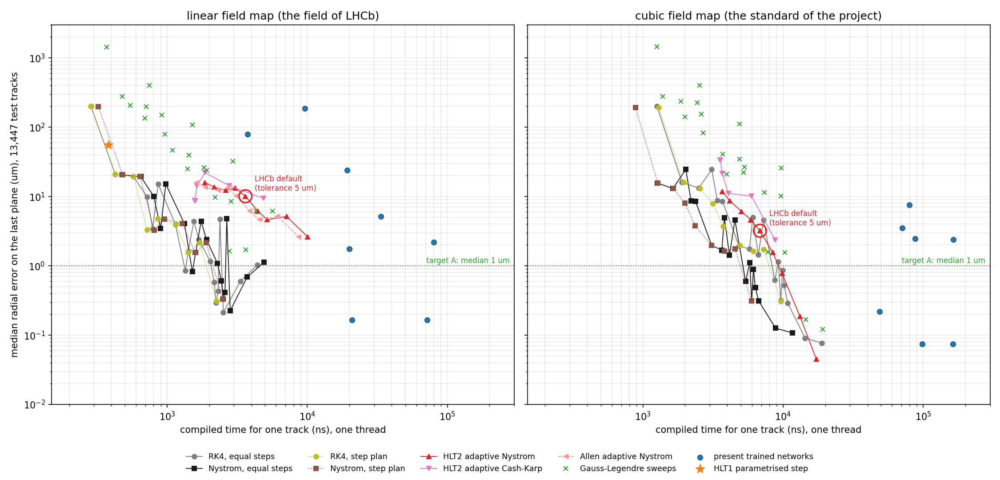
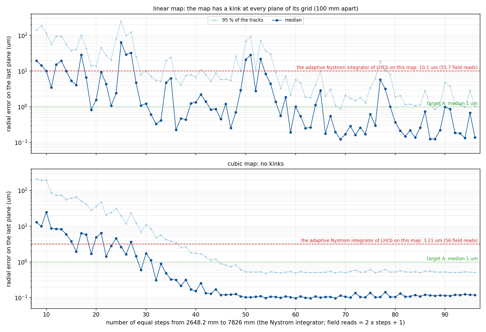
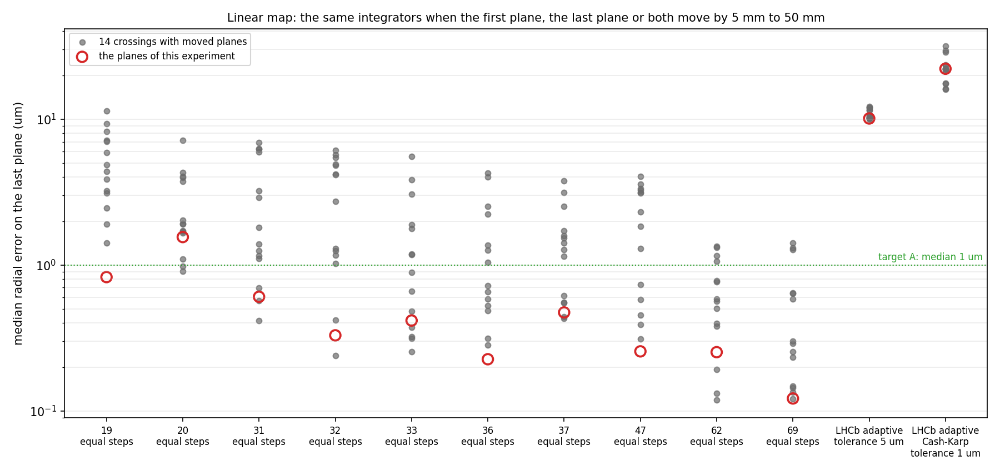
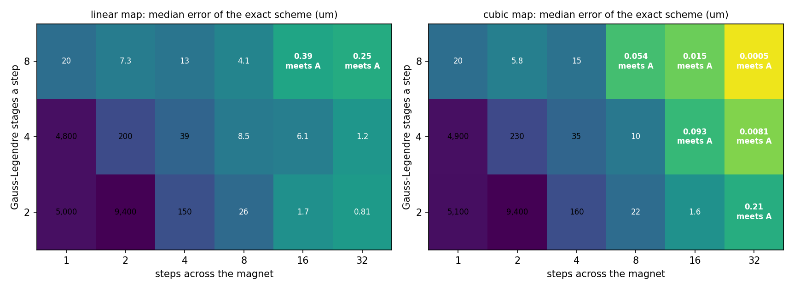

# Stage 1: results

Written by `scripts/analysis.py` from the tables in `results/`. No network is trained in this stage. 13,447 test tracks, field map v8r1 (magnet up), one crossing from 2648.2 mm to 7826 mm. Timed on stbc-i3.nikhef.nl, one thread, one pinned core, one track a call.

Target A: median error 1 um or less, 95 % of the tracks at 10 um or less, the median of every momentum band at 3 um or less. Target B: 5 um, 40 um, 10 um. The LHCb level: not worse than the adaptive Nystrom integrator of LHCb at its default tolerance, in the same three numbers.

## Summary

1. **The LHCb reference on our tracks.** The adaptive Nystrom integrator at its default tolerance: 55.7 field reads, 3.63 us, median error 10.1 um, 95 % 38.8 um, worst band 16.2 um. The adaptive Cash-Karp integrator: 42.6 reads, 1.86 us, 22.2 um, 112 um, 47.3 um.
2. **A fixed-step integrator with no network is faster and more accurate than both, on the planes of this experiment.** The fastest method at the LHCb level or better is "RK4, 19 equal steps": 1.35 us, 0.854 um, 14.5 um, 4.84 um. The fastest that meets target B is "RK4, 19 equal steps": 1.35 us. The fastest that meets target A is "RK4, 31 equal steps": 2.17 us, 0.582 um, 7.03 um, 2.67 um.
3. **That accuracy is tied to the planes.** The linear map has a kink at every plane of its grid, and the error of a fixed-step integrator depends on where its steps fall on that grid: with 25 equal steps the median error is 63.4 um, with 32 it is 0.33 um. When the planes of the crossing move by 5 mm to 50 mm, the integrator with 19 steps gives 1.4 um to 11 um, with 32 steps 0.24 um to 6.1 um, and with 69 steps 0.12 um to 1.4 um. The adaptive integrator of LHCb gives 9.99 um to 12.2 um on the same crossings. So on the LHCb map a fixed-step integrator with 32 steps stays better than LHCb, but it does not hold 1 um when the planes change.
4. **The number of field reads does not set the time of one track.** With 32 steps the Nystrom integrator reads the field 65 times and takes 2.52 us; RK4 reads it 128 times and takes 2.23 us. The likely cause: each operation of a step waits for the result of the one before it, and that chain sets the time, not the count of reads. This cause is not tested here.
5. **The two readings of the map are 22.9 um apart.** That is the median distance on the last plane between the linear reading (LHCb) and the cubic reading (the standard of this project) of the same map points; 95 % of the tracks are within 163 um. Against the cubic reference the LHCb integrator has a median error of 25.9 um. Every method that reads the map linearly has this error against the cubic reference.
6. **On the cubic map** the error falls smoothly with the number of steps. The fastest classical method that meets target A is "Nystrom, 29 equal steps": 5.41 us, 0.594 um. A cubic field read costs 66 ns, a linear one 11 ns.
7. **Layouts on the linear map.** 2 of 18 layouts have an exact scheme that meets target A: 16 steps x 8 stages, 32 steps x 8 stages. A chained network with a summed end state cannot be better than the exact scheme of its layout, so on this map it reads the field at least 128 times.
8. **Layouts on the cubic map.** 6 of 18 layouts have an exact scheme that meets target A: 8 steps x 8 stages, 16 steps x 4 stages, 16 steps x 8 stages, 32 steps x 2 stages, 32 steps x 4 stages, 32 steps x 8 stages. A chained network with a summed end state cannot be better than the exact scheme of its layout, so on this map it reads the field at least 64 times.

## 1. The classical frontier

**The fastest method of each family for each target** (`results/cheapest_methods.csv`):

| Map | Target | Family | Fastest method that meets it | Field reads | Time a track (ns) | Median error (um) | 95 % (um) | Worst band (um) |
|---|---|---|---|---|---|---|---|---|
| linear | target A | RK4, equal steps | RK4, 31 equal steps | 124 | 2169 | 0.582 | 7.03 | 2.67 |
| linear | target A | Nystrom, equal steps | Nystrom, 31 equal steps | 63 | 2440 | 0.606 | 7.12 | 2.74 |
| linear | target A | RK4, step plan | RK4 on a step plan, 32 steps | 128 | 2249 | 0.313 | 5.52 | 1.56 |
| linear | target A | Nystrom, step plan | Nystrom on a step plan, 32 steps | 65 | 2499 | 0.33 | 5.49 | 1.56 |
| linear | target A | HLT2 adaptive Nystrom | none |  |  |  |  |  |
| linear | target A | HLT2 adaptive Cash-Karp | none |  |  |  |  |  |
| linear | target A | Allen adaptive Nystrom | none |  |  |  |  |  |
| linear | target A | Gauss-Legendre sweeps | none |  |  |  |  |  |
| linear | target B | RK4, equal steps | RK4, 19 equal steps | 76 | 1347 | 0.854 | 14.5 | 4.84 |
| linear | target B | Nystrom, equal steps | Nystrom, 19 equal steps | 39 | 1514 | 0.827 | 14.2 | 4.64 |
| linear | target B | RK4, step plan | RK4 on a step plan, 20 steps | 80 | 1411 | 1.56 | 14 | 6.17 |
| linear | target B | Nystrom, step plan | Nystrom on a step plan, 20 steps | 41 | 1586 | 1.56 | 13.9 | 6.05 |
| linear | target B | HLT2 adaptive Nystrom | HLT2 adaptive Nystrom (STEP), tolerance 0.1 um | 159 | 10041 | 2.64 | 10.4 | 5.73 |
| linear | target B | HLT2 adaptive Cash-Karp | none |  |  |  |  |  |
| linear | target B | Allen adaptive Nystrom | Allen adaptive Nystrom, tolerance 0.1 um | 158 | 8714 | 2.61 | 10.5 | 5.68 |
| linear | target B | Gauss-Legendre sweeps | none |  |  |  |  |  |
| linear | the LHCb level | RK4, equal steps | RK4, 19 equal steps | 76 | 1347 | 0.854 | 14.5 | 4.84 |
| linear | the LHCb level | Nystrom, equal steps | Nystrom, 19 equal steps | 39 | 1514 | 0.827 | 14.2 | 4.64 |
| linear | the LHCb level | RK4, step plan | RK4 on a step plan, 20 steps | 80 | 1411 | 1.56 | 14 | 6.17 |
| linear | the LHCb level | Nystrom, step plan | Nystrom on a step plan, 20 steps | 41 | 1586 | 1.56 | 13.9 | 6.05 |
| linear | the LHCb level | HLT2 adaptive Nystrom | HLT2 adaptive Nystrom (STEP), tolerance 5 um | 55.7 | 3627 | 10.1 | 38.8 | 16.2 |
| linear | the LHCb level | HLT2 adaptive Cash-Karp | none |  |  |  |  |  |
| linear | the LHCb level | Allen adaptive Nystrom | Allen adaptive Nystrom, tolerance 0.3 um | 109 | 6132 | 5.17 | 20.7 | 10.5 |
| linear | the LHCb level | Gauss-Legendre sweeps | none |  |  |  |  |  |
| cubic | target A | RK4, equal steps | RK4, 29 equal steps | 116 | 8736 | 0.621 | 6.86 | 2.99 |
| cubic | target A | Nystrom, equal steps | Nystrom, 29 equal steps | 59 | 5410 | 0.594 | 7.01 | 2.98 |
| cubic | target A | RK4, step plan | RK4 on a step plan, 32 steps | 128 | 9679 | 0.306 | 4.79 | 1.87 |
| cubic | target A | Nystrom, step plan | Nystrom on a step plan, 32 steps | 65 | 5961 | 0.31 | 4.84 | 1.91 |
| cubic | target A | HLT2 adaptive Nystrom | HLT2 adaptive Nystrom (STEP), tolerance 1 um | 81.7 | 9835 | 0.781 | 2.97 | 0.881 |
| cubic | target A | HLT2 adaptive Cash-Karp | none |  |  |  |  |  |
| cubic | target A | Gauss-Legendre sweeps | Gauss-Legendre, 16 steps x 4 stages, 3 sweeps | 256 | 19117 | 0.122 | 1.96 | 0.653 |
| cubic | target B | RK4, equal steps | RK4, 19 equal steps | 76 | 5762 | 1.75 | 27.8 | 7.45 |
| cubic | target B | Nystrom, equal steps | Nystrom, 19 equal steps | 39 | 3658 | 1.69 | 27.9 | 7 |
| cubic | target B | RK4, step plan | RK4 on a step plan, 20 steps | 80 | 6121 | 1.62 | 26.6 | 8.33 |
| cubic | target B | Nystrom, step plan | Nystrom on a step plan, 20 steps | 41 | 3821 | 1.63 | 26.6 | 8.2 |
| cubic | target B | HLT2 adaptive Nystrom | HLT2 adaptive Nystrom (STEP), tolerance 10 um | 48 | 5897 | 4.62 | 24.9 | 8.89 |
| cubic | target B | HLT2 adaptive Cash-Karp | HLT2 adaptive Cash-Karp, tolerances x 0.1 | 95.6 | 8791 | 2.37 | 16.8 | 5.07 |
| cubic | target B | Gauss-Legendre sweeps | Gauss-Legendre, 16 steps x 4 stages, 2 sweeps | 192 | 14534 | 0.169 | 7.86 | 4.74 |
| cubic | the LHCb level | RK4, equal steps | RK4, 29 equal steps | 116 | 8736 | 0.621 | 6.86 | 2.99 |
| cubic | the LHCb level | Nystrom, equal steps | Nystrom, 29 equal steps | 59 | 5410 | 0.594 | 7.01 | 2.98 |
| cubic | the LHCb level | RK4, step plan | RK4 on a step plan, 32 steps | 128 | 9679 | 0.306 | 4.79 | 1.87 |
| cubic | the LHCb level | Nystrom, step plan | Nystrom on a step plan, 32 steps | 65 | 5961 | 0.31 | 4.84 | 1.91 |
| cubic | the LHCb level | HLT2 adaptive Nystrom | HLT2 adaptive Nystrom (STEP), tolerance 5 um | 56 | 6839 | 3.21 | 15.5 | 4.45 |
| cubic | the LHCb level | HLT2 adaptive Cash-Karp | none |  |  |  |  |  |
| cubic | the LHCb level | Gauss-Legendre sweeps | Gauss-Legendre, 16 steps x 4 stages, 3 sweeps | 256 | 19117 | 0.122 | 1.96 | 0.653 |

## 2. The error of a fixed-step integrator and the grid of the map

On the linear map the error jumps by a factor of up to 100 from one number of steps to the next. The linear reading has a kink at every plane of the grid of the map, 100 mm apart, and every track meets these kinks at the same z. A fixed-step integrator makes a small error at each kink. When the step length is close to a whole number of cells, the kinks fall at the same place in every step and the errors add; for other step lengths they cancel in part. On the cubic map there are no kinks and the error falls smoothly (the level of 0.1 um is single precision). The training tracks give the same curve as the test tracks (`results/step_length_scan.csv`).

| Equal steps | Step length (mm) | Linear map: median (um) | 95 % (um) | meets | Cubic map: median (um) | 95 % (um) | meets |
|---|---|---|---|---|---|---|---|
| 16 | 323.6 | 4.07 | 40 |  | 1.97 | 66.4 |  |
| 19 | 272.5 | 0.827 | 14.2 | B | 1.69 | 27.9 | B |
| 20 | 258.9 | 1.56 | 13.9 | B | 4.92 | 35.8 |  |
| 24 | 215.7 | 2.39 | 80 |  | 4.61 | 31.2 |  |
| 25 | 207.1 | 63.4 | 252 |  | 2.63 | 19.8 | B |
| 26 | 199.1 | 29.1 | 97.7 |  | 1.63 | 11.7 | B |
| 29 | 178.5 | 1.09 | 8.08 | B | 0.594 | 7.01 | A |
| 31 | 167.0 | 0.606 | 7.12 | A | 1.12 | 8.46 | B |
| 32 | 161.8 | 0.33 | 5.49 | A | 0.31 | 4.84 | A |
| 33 | 156.9 | 0.416 | 5.23 | A | 0.887 | 5.65 | B |
| 34 | 152.3 | 4.79 | 19.8 |  | 0.487 | 4.31 | A |
| 35 | 147.9 | 6.31 | 24.5 |  | 0.326 | 3.78 | A |
| 36 | 143.8 | 0.226 | 6.09 | A | 0.314 | 3.47 | A |
| 48 | 107.9 | 0.695 | 26 | B | 0.126 | 0.829 | A |
| 50 | 103.6 | 20.8 | 68.1 |  | 0.102 | 0.533 | A |
| 64 | 80.9 | 1.12 | 4.18 | B | 0.108 | 0.514 | A |
| 69 | 75.0 | 0.122 | 0.881 | A | 0.115 | 0.531 | A |
| 77 | 67.2 | 5.74 | 18.7 |  | 0.104 | 0.538 | A |
| 96 | 53.9 | 0.139 | 1.04 | A | 0.118 | 0.51 | A |

The same integrators on 15 crossings of the linear map: the planes of this experiment, and 14 crossings with the first plane, the last plane or both moved by 5 mm to 50 mm (`results/shifted_planes.csv`). Median error in um:

| Method | Field reads | Our planes: median (um) | Moved planes: lowest median (um) | highest median (um) | highest 95 % (um) | Moved crossings that meet target A |
|---|---|---|---|---|---|---|
| Nystrom, 19 equal steps | 39 | 0.827 | 1.4 | 11 | 47.5 | 0 of 14 |
| Nystrom, 20 equal steps | 41 | 1.56 | 0.9 | 7.1 | 27.3 | 0 of 14 |
| Nystrom, 31 equal steps | 63 | 0.606 | 0.42 | 6.9 | 24.9 | 2 of 14 |
| Nystrom, 32 equal steps | 65 | 0.33 | 0.24 | 6.1 | 25.6 | 2 of 14 |
| Nystrom, 33 equal steps | 67 | 0.416 | 0.26 | 5.6 | 22 | 6 of 14 |
| Nystrom, 36 equal steps | 73 | 0.226 | 0.28 | 4.3 | 14.6 | 7 of 14 |
| Nystrom, 37 equal steps | 75 | 0.473 | 0.43 | 3.8 | 14.4 | 5 of 14 |
| Nystrom, 47 equal steps | 95 | 0.256 | 0.31 | 4.1 | 20.2 | 4 of 14 |
| Nystrom, 62 equal steps | 125 | 0.253 | 0.12 | 1.3 | 4.97 | 10 of 14 |
| Nystrom, 69 equal steps | 139 | 0.122 | 0.12 | 1.4 | 6.01 | 11 of 14 |
| HLT2 adaptive Nystrom, tolerance 5 um | 55.7 | 10.1 | 10 | 12 | 43.7 | 0 of 14 |
| HLT2 adaptive Cash-Karp, tolerance 1 um | 42.6 | 22.2 | 16 | 32 | 128 | 0 of 14 |

## 3. Field reads and time

The Nystrom integrator reads the field at three points a step and shares one of them with the next step; RK4 reads it at four. The errors are the same. On the linear map the Nystrom integrator is not faster, although it reads the field half as often. The likely cause: a read of the linear map is cheap, and the time of a step is set by the chain of operations in which each one waits for the result of the one before it (in the Nystrom step all four evaluations of the slopes are in one chain; in the RK4 step two reads can run side by side). This cause is not tested here; a test is to carry several tracks in one loop. On the cubic map a read is expensive and the Nystrom integrator is faster.

| Equal steps | Linear map: RK4 reads | RK4 time (ns) | Nystrom reads | Nystrom time (ns) | Cubic map: RK4 reads | RK4 time (ns) | Nystrom reads | Nystrom time (ns) |
|---|---|---|---|---|---|---|---|---|
| 8 | 32 | 574 | 17 | 650 | 32 | 2503 | 17 | 1638 |
| 16 | 64 | 1147 | 33 | 1330 | 64 | 4864 | 33 | 3099 |
| 20 | 80 | 1417 | 41 | 1599 | 80 | 6081 | 41 | 3816 |
| 32 | 128 | 2235 | 65 | 2518 | 128 | 9633 | 65 | 5978 |
| 64 | 256 | 4415 | 129 | 4917 | 256 | 18963 | 129 | 11662 |

## 4. The LHCb integrators at other tolerances

The tolerance of the adaptive Nystrom integrator is scanned from 0.1 um to 100 um (default 5 um); the two tolerances of the Cash-Karp integrator are scaled together (default: factor 1). On the linear map a tighter tolerance buys little: the step control meets the kinks of the map.

**Linear map**

| Method | Field reads | Time a track (ns) | Median error (um) | 95 % (um) | Worst band (um) |
|---|---|---|---|---|---|
| HLT2 adaptive Nystrom (STEP), tolerance 0.1 um | 159 | 10041 | 2.64 | 10.4 | 5.73 |
| HLT2 adaptive Nystrom (STEP), tolerance 0.3 um | 110 | 7116 | 5.18 | 20.8 | 10.6 |
| HLT2 adaptive Nystrom (STEP), tolerance 1 um | 81.1 | 5191 | 4.65 | 38.4 | 29.8 |
| HLT2 adaptive Nystrom (STEP), tolerance 2 um | 69 | 4444 | 6.13 | 33.6 | 16.8 |
| HLT2 adaptive Nystrom (STEP), tolerance 5 um | 55.7 | 3627 | 10.1 | 38.8 | 16.2 |
| HLT2 adaptive Nystrom (STEP), tolerance 10 um | 47.9 | 3059 | 13.2 | 64.9 | 30.1 |
| HLT2 adaptive Nystrom (STEP), tolerance 20 um | 41.1 | 2619 | 12.3 | 109 | 67.7 |
| HLT2 adaptive Nystrom (STEP), tolerance 50 um | 33.7 | 2165 | 13.7 | 64.4 | 29.5 |
| HLT2 adaptive Nystrom (STEP), tolerance 100 um | 29.2 | 1864 | 15.9 | 86.3 | 36.2 |
| HLT2 adaptive Cash-Karp, tolerances x 0.1 | 116 | 4862 | 9.45 | 56.7 | 34.9 |
| HLT2 adaptive Cash-Karp, tolerances x 0.3 | 63.7 | 2776 | 14.3 | 71.9 | 40.8 |
| HLT2 adaptive Cash-Karp, tolerances x 1 | 42.6 | 1862 | 22.2 | 112 | 47.3 |
| HLT2 adaptive Cash-Karp, tolerances x 3 | 37.2 | 1633 | 14.3 | 159 | 99.6 |
| HLT2 adaptive Cash-Karp, tolerances x 10 | 36.3 | 1575 | 8.76 | 108 | 56 |
| HLT2 adaptive Cash-Karp, tolerances x 30 | 36 | 1580 | 8.7 | 105 | 54 |
| Allen adaptive Nystrom, tolerance 0.1 um | 158 | 8714 | 2.61 | 10.5 | 5.68 |
| Allen adaptive Nystrom, tolerance 0.3 um | 109 | 6132 | 5.17 | 20.7 | 10.5 |
| Allen adaptive Nystrom, tolerance 1 um | 80.1 | 4557 | 4.63 | 38.3 | 29.7 |
| Allen adaptive Nystrom, tolerance 2 um | 68 | 3886 | 6.14 | 33.5 | 17 |
| Allen adaptive Nystrom, tolerance 5 um | 54.7 | 3129 | 10.1 | 38.9 | 16.2 |
| Allen adaptive Nystrom, tolerance 10 um | 46.9 | 2693 | 13.2 | 65 | 30.2 |
| Allen adaptive Nystrom, tolerance 20 um | 40.1 | 2315 | 12.3 | 108 | 67.8 |
| Allen adaptive Nystrom, tolerance 50 um | 32.7 | 1881 | 13.7 | 64.3 | 29.5 |
| Allen adaptive Nystrom, tolerance 100 um | 28.2 | 1615 | 15.9 | 86.3 | 36.1 |

**Cubic map**

| Method | Field reads | Time a track (ns) | Median error (um) | 95 % (um) | Worst band (um) |
|---|---|---|---|---|---|
| HLT2 adaptive Nystrom (STEP), tolerance 0.1 um | 145 | 17307 | 0.0449 | 0.187 | 0.0578 |
| HLT2 adaptive Nystrom (STEP), tolerance 0.3 um | 110 | 13209 | 0.186 | 0.699 | 0.225 |
| HLT2 adaptive Nystrom (STEP), tolerance 1 um | 81.7 | 9835 | 0.781 | 2.97 | 0.881 |
| HLT2 adaptive Nystrom (STEP), tolerance 2 um | 69.3 | 8455 | 1.55 | 6.78 | 1.81 |
| HLT2 adaptive Nystrom (STEP), tolerance 5 um | 56 | 6839 | 3.21 | 15.5 | 4.45 |
| HLT2 adaptive Nystrom (STEP), tolerance 10 um | 48 | 5897 | 4.62 | 24.9 | 8.89 |
| HLT2 adaptive Nystrom (STEP), tolerance 20 um | 41.2 | 5054 | 6.09 | 37.4 | 14.3 |
| HLT2 adaptive Nystrom (STEP), tolerance 50 um | 33.7 | 4180 | 8.65 | 61.2 | 18.7 |
| HLT2 adaptive Nystrom (STEP), tolerance 100 um | 29.3 | 3680 | 11.8 | 89.5 | 28.1 |
| HLT2 adaptive Cash-Karp, tolerances x 0.1 | 95.6 | 8791 | 2.37 | 16.8 | 5.07 |
| HLT2 adaptive Cash-Karp, tolerances x 0.3 | 63.7 | 5957 | 10.2 | 48.9 | 16.7 |
| HLT2 adaptive Cash-Karp, tolerances x 1 | 42.8 | 4068 | 11.2 | 98.5 | 39.3 |
| HLT2 adaptive Cash-Karp, tolerances x 3 | 37.4 | 3681 | 21.5 | 97.5 | 42.3 |
| HLT2 adaptive Cash-Karp, tolerances x 10 | 36.4 | 3574 | 33.7 | 224 | 107 |
| HLT2 adaptive Cash-Karp, tolerances x 30 | 36.1 | 3558 | 33.7 | 236 | 114 |

## 5. The two readings of the map

The test tracks of the cubic track set, carried with methods that read the map as named, scored against the cubic reference (`results/two_readings_of_the_map.csv`):

| Method | Field reads | Median error (um) | 95 % (um) | below 3 GeV | 3 to 8 GeV | 8 to 20 GeV | 20 to 50 GeV | above 50 GeV |
|---|---|---|---|---|---|---|---|---|
| The linear reading, integrated with 2,048 steps | 8,192 | 22.9 | 163 | 80.1 | 38.5 | 16.6 | 7.27 | 2.86 |
| HLT2 adaptive Nystrom, linear reading (as LHCb runs it) | 55.7 | 25.9 | 169 | 83.7 | 41.7 | 17.8 | 7.33 | 3.05 |
| HLT2 adaptive Cash-Karp, linear reading (as LHCb runs it) | 42.6 | 31.7 | 203 | 102 | 55.8 | 21.5 | 8.07 | 2.84 |
| HLT2 adaptive Nystrom on the cubic reading | 56 | 3.21 | 15.5 | 4.45 | 4.29 | 2.92 | 1.24 | 1.04 |
| HLT2 adaptive Cash-Karp on the cubic reading | 42.8 | 11.2 | 98.5 | 39.3 | 22.9 | 6.3 | 3.91 | 3.63 |

## 6. Steps of unequal length

A step plan puts shorter steps where a step costs more error (`scripts/step_plans.py`). The exponent beta of a plan is chosen on 2,000 training tracks; beta = 0 is equal steps. Equal steps are chosen in 20 of 36 cases. The table gives the Nystrom integrator on the test tracks: a plan lowers the error at some numbers of steps and changes nothing at 16 and 32.

| Map | Steps | Chosen beta | Equal steps: median (um) | 95 % (um) | Step plan: median (um) | 95 % (um) |
|---|---|---|---|---|---|---|
| linear | 6 | 0 | 20.6 | 216 | 20.6 | 216 |
| linear | 8 | 0 | 19.4 | 141 | 19.4 | 141 |
| linear | 10 | 0.1 | 10 | 115 | 3.29 | 53.8 |
| linear | 12 | 0.3 | 15.2 | 94.7 | 4.76 | 63.9 |
| linear | 16 | 0 | 4.07 | 40 | 4.07 | 40 |
| linear | 20 | 0 | 1.56 | 13.9 | 1.56 | 13.9 |
| linear | 24 | 0.1 | 2.39 | 80 | 2.17 | 17.3 |
| linear | 32 | 0 | 0.33 | 5.49 | 0.33 | 5.49 |
| cubic | 6 | 0 | 15.7 | 272 | 15.7 | 272 |
| cubic | 8 | 0 | 13 | 211 | 13 | 211 |
| cubic | 10 | 0.1 | 24.7 | 194 | 8.01 | 115 |
| cubic | 12 | 0.1 | 8.51 | 72.5 | 3.79 | 63.8 |
| cubic | 16 | 0 | 1.97 | 66.4 | 1.97 | 66.4 |
| cubic | 20 | 0.1 | 4.92 | 35.8 | 1.63 | 26.6 |
| cubic | 24 | 0.2 | 4.61 | 31.2 | 1.75 | 17.5 |
| cubic | 32 | 0 | 0.31 | 4.84 | 0.31 | 4.84 |

## 7. The floor of each layout

The exact Gauss-Legendre scheme of a layout is what a network with a summed end state gives when its loss is zero. It is computed with sweeps of the stage map until nothing changes.

| Map | Steps | Stages | Stage points (field reads of one sweep) | Median error (um) | 95 % (um) | Worst band (um) | Meets target A | Sweeps converged |
|---|---|---|---|---|---|---|---|---|
| linear | 1 | 2 | 2 | 5,030 | 17,600 | 8,220 | no | yes |
| linear | 1 | 4 | 4 | 4,840 | 34,500 | 16,000 | no | yes |
| linear | 1 | 8 | 8 | 19.8 | 946 | 154 | no | yes |
| linear | 2 | 2 | 4 | 9,440 | 40,500 | 29,500 | no | yes |
| linear | 2 | 4 | 8 | 198 | 1,140 | 636 | no | yes |
| linear | 2 | 8 | 16 | 7.31 | 108 | 32 | no | yes |
| linear | 4 | 2 | 8 | 151 | 2,090 | 573 | no | yes |
| linear | 4 | 4 | 16 | 39.4 | 217 | 126 | no | yes |
| linear | 4 | 8 | 32 | 12.5 | 80.4 | 38.5 | no | yes |
| linear | 8 | 2 | 16 | 26.3 | 159 | 87 | no | yes |
| linear | 8 | 4 | 32 | 8.52 | 56.5 | 28.3 | no | yes |
| linear | 8 | 8 | 64 | 4.06 | 53.6 | 16.1 | no | yes |
| linear | 16 | 2 | 32 | 1.73 | 54.9 | 10.3 | no | yes |
| linear | 16 | 4 | 64 | 6.08 | 60.8 | 21.7 | no | yes |
| linear | 16 | 8 | 128 | 0.391 | 2.3 | 1.28 | yes | yes |
| linear | 32 | 2 | 64 | 0.813 | 5.63 | 3.26 | no | yes |
| linear | 32 | 4 | 128 | 1.17 | 4.16 | 3.39 | no | yes |
| linear | 32 | 8 | 256 | 0.247 | 1.02 | 0.73 | yes | yes |
| cubic | 1 | 2 | 2 | 5,100 | 17,700 | 8,380 | no | yes |
| cubic | 1 | 4 | 4 | 4,930 | 34,800 | 16,200 | no | yes |
| cubic | 1 | 8 | 8 | 19.8 | 919 | 151 | no | yes |
| cubic | 2 | 2 | 4 | 9,430 | 40,400 | 29,500 | no | yes |
| cubic | 2 | 4 | 8 | 228 | 1,220 | 724 | no | yes |
| cubic | 2 | 8 | 16 | 5.83 | 216 | 30.7 | no | yes |
| cubic | 4 | 2 | 8 | 155 | 2,060 | 579 | no | yes |
| cubic | 4 | 4 | 16 | 35.2 | 245 | 113 | no | yes |
| cubic | 4 | 8 | 32 | 14.5 | 100 | 47.6 | no | yes |
| cubic | 8 | 2 | 16 | 22.2 | 203 | 80 | no | yes |
| cubic | 8 | 4 | 32 | 10.2 | 72.2 | 35.7 | no | yes |
| cubic | 8 | 8 | 64 | 0.0538 | 1.44 | 0.415 | yes | yes |
| cubic | 16 | 2 | 32 | 1.56 | 49.7 | 7.63 | no | yes |
| cubic | 16 | 4 | 64 | 0.0933 | 1.88 | 0.603 | yes | yes |
| cubic | 16 | 8 | 128 | 0.0153 | 0.122 | 0.0563 | yes | yes |
| cubic | 32 | 2 | 64 | 0.214 | 3.48 | 1.31 | yes | yes |
| cubic | 32 | 4 | 128 | 0.00815 | 0.0835 | 0.0372 | yes | yes |
| cubic | 32 | 8 | 256 | 0.000501 | 0.00587 | 0.00242 | yes | yes |

## 8. What a chained network would cost at target A

For each layout whose exact scheme meets target A: the lowest time of a chained network with a summed end state. It is one network call a step and one field read a stage point, with the costs of stage 0: a call of 80 ns (2 x 16), 135 ns (2 x 32) or 234 ns (2 x 64) and a read of 11 ns (linear) or 66 ns (cubic). It assumes that the small network reaches the exact scheme, which no present network does (`results/what_a_chained_network_costs.csv`).

| Map | Steps | Stages | Stage points | Floor: median (um) | Lowest time, 2 x 16 (ns) | 2 x 32 (ns) | 2 x 64 (ns) | Fastest classical method at target A (ns) |
|---|---|---|---|---|---|---|---|---|
| linear | 16 | 8 | 128 | 0.391 | 2629 | 3511 | 5090 | 2169 |
| linear | 32 | 8 | 256 | 0.247 | 5258 | 7022 | 10179 | 2169 |
| cubic | 8 | 8 | 64 | 0.0538 | 4870 | 5310 | 6100 | 5410 |
| cubic | 16 | 4 | 64 | 0.0933 | 5508 | 6390 | 7968 | 5410 |
| cubic | 16 | 8 | 128 | 0.0153 | 9739 | 10621 | 12199 | 5410 |
| cubic | 32 | 2 | 64 | 0.214 | 6785 | 8548 | 11705 | 5410 |
| cubic | 32 | 4 | 128 | 0.00815 | 11016 | 12779 | 15937 | 5410 |
| cubic | 32 | 8 | 256 | 0.000501 | 19478 | 21242 | 24399 | 5410 |

## 9. Every method of the stage

**Linear map**, fastest first; A or B = the target that the method meets on the planes of this experiment.

| Method | Precision | Field reads | Time a track (ns) | Cold caches (ns) | Median error (um) | 95 % (um) | Worst band (um) |  |
|---|---|---|---|---|---|---|---|---|
| Gauss-Legendre, 2 steps x 2 stages, 1 sweeps | float | 8 | 235 | 1563 | 10,800 | 70,000 | 57,300 |  |
| RK4 on a step plan, 4 steps | float | 16 | 286 | 2365 | 200 | 2,990 | 767 |  |
| RK4, 4 equal steps | float | 16 | 286 | 2294 | 200 | 2,990 | 767 |  |
| Nystrom on a step plan, 4 steps | float | 9 | 322 | 2444 | 199 | 2,950 | 760 |  |
| Gauss-Legendre, 2 steps x 2 stages, 2 sweeps | float | 12 | 343 | 1658 | 9,440 | 42,000 | 31,300 |  |
| Gauss-Legendre, 2 steps x 4 stages, 1 sweeps | float | 16 | 372 | 2059 | 1,440 | 33,800 | 26,900 |  |
| RK4 on a step plan, 6 steps | float | 24 | 426 | 2841 | 21 | 219 | 81.1 |  |
| RK4, 6 equal steps | float | 24 | 427 | 3036 | 21 | 219 | 81 |  |
| Gauss-Legendre, 2 steps x 2 stages, 3 sweeps | float | 16 | 453 | 1668 | 9,440 | 40,600 | 29,600 |  |
| Nystrom, 6 equal steps | float | 13 | 478 | 2971 | 20.6 | 216 | 79.2 |  |
| Gauss-Legendre, 4 steps x 2 stages, 1 sweeps | float | 16 | 480 | 2084 | 278 | 9,170 | 7,100 |  |
| Nystrom on a step plan, 6 steps | float | 13 | 482 | 3106 | 20.6 | 216 | 79.2 |  |
| Gauss-Legendre, 2 steps x 4 stages, 2 sweeps | float | 24 | 545 | 2290 | 207 | 3,260 | 2,210 |  |
| RK4, 8 equal steps | float | 32 | 574 | 3702 | 19.6 | 146 | 67.4 |  |
| RK4 on a step plan, 8 steps | float | 32 | 576 | 3522 | 19.5 | 145 | 67 |  |
| Nystrom on a step plan, 8 steps | float | 17 | 642 | 3928 | 19.4 | 141 | 63.7 |  |
| Nystrom, 8 equal steps | float | 17 | 650 | 3757 | 19.4 | 141 | 63.7 |  |
| Gauss-Legendre, 4 steps x 2 stages, 2 sweeps | float | 24 | 695 | 2360 | 135 | 1,870 | 332 |  |
| Gauss-Legendre, 2 steps x 4 stages, 3 sweeps | float | 32 | 709 | 2545 | 198 | 1,280 | 724 |  |
| RK4, 10 equal steps | float | 40 | 718 | 4112 | 9.92 | 114 | 57.3 |  |
| RK4 on a step plan, 10 steps | float | 40 | 719 | 4314 | 3.34 | 54.3 | 18.9 |  |
| Gauss-Legendre, 4 steps x 4 stages, 1 sweeps | float | 32 | 748 | 2996 | 405 | 10,200 | 8,460 |  |
| RK4, 11 equal steps | float | 44 | 790 | 4608 | 3.44 | 54.8 | 18.3 |  |
| Nystrom, 10 equal steps | float | 21 | 804 | 4618 | 10 | 115 | 57.5 |  |
| Nystrom on a step plan, 10 steps | float | 21 | 807 | 4508 | 3.29 | 53.8 | 18.3 |  |
| RK4 on a step plan, 12 steps | float | 48 | 856 | 5120 | 4.77 | 64.1 | 27.3 |  |
| RK4, 12 equal steps | float | 48 | 863 | 4960 | 15.2 | 95.7 | 55.4 |  |
| Nystrom, 11 equal steps | float | 23 | 899 | 5064 | 3.46 | 56.2 | 18.3 |  |
| Gauss-Legendre, 4 steps x 2 stages, 3 sweeps | float | 32 | 917 | 2544 | 151 | 2,080 | 568 |  |
| Nystrom on a step plan, 12 steps | float | 25 | 958 | 5260 | 4.76 | 63.9 | 26.9 |  |
| Gauss-Legendre, 8 steps x 2 stages, 1 sweeps | float | 32 | 963 | 3286 | 79 | 2,810 | 2,200 |  |
| Nystrom, 12 equal steps | float | 25 | 979 | 5280 | 15.2 | 94.7 | 54.9 |  |
| Gauss-Legendre, 4 steps x 4 stages, 2 sweeps | float | 48 | 1092 | 3587 | 46.5 | 506 | 362 |  |
| RK4 on a step plan, 16 steps | float | 64 | 1146 | 6502 | 4.04 | 39.9 | 16.6 |  |
| RK4, 16 equal steps | float | 64 | 1147 | 6256 | 3.97 | 39.8 | 16.4 |  |
| Nystrom on a step plan, 16 steps | float | 33 | 1282 | 6642 | 4.07 | 40 | 17 |  |
| Nystrom, 16 equal steps | float | 33 | 1330 | 6528 | 4.07 | 40 | 17 |  |
| RK4, 19 equal steps | float | 76 | 1347 | 7089 | 0.854 | 14.5 | 4.84 | B |
| Gauss-Legendre, 8 steps x 2 stages, 2 sweeps | float | 48 | 1396 | 3632 | 25 | 135 | 62 |  |
| RK4 on a step plan, 20 steps | float | 80 | 1411 | 7479 | 1.56 | 14 | 6.17 | B |
| RK4, 20 equal steps | float | 80 | 1417 | 7334 | 1.61 | 14.1 | 6.32 | B |
| Gauss-Legendre, 4 steps x 4 stages, 3 sweeps | float | 64 | 1431 | 3988 | 39.9 | 222 | 133 |  |
| Gauss-Legendre, 8 steps x 4 stages, 1 sweeps | float | 64 | 1512 | 5125 | 109 | 2,820 | 2,340 |  |
| Nystrom, 19 equal steps | float | 39 | 1514 | 7244 | 0.827 | 14.2 | 4.64 | B |
| RK4, 22 equal steps | float | 88 | 1552 | 8105 | 4.41 | 27.2 | 14.3 |  |
| HLT2 adaptive Cash-Karp, tolerances x 10 | double | 36.3 | 1575 | 6668 | 8.76 | 108 | 56 |  |
| HLT2 adaptive Cash-Karp, tolerances x 30 | double | 36 | 1580 | 6598 | 8.7 | 105 | 54 |  |
| Nystrom on a step plan, 20 steps | float | 41 | 1586 | 7845 | 1.56 | 13.9 | 6.05 | B |
| Nystrom, 20 equal steps | float | 41 | 1599 | 7870 | 1.56 | 13.9 | 6.05 | B |
| Allen adaptive Nystrom, tolerance 100 um | float | 28.2 | 1615 | 7644 | 15.9 | 86.3 | 36.1 |  |
| HLT2 adaptive Cash-Karp, tolerances x 3 | double | 37.2 | 1633 | 6788 | 14.3 | 159 | 99.6 |  |
| RK4, 24 equal steps | float | 96 | 1685 | 8396 | 2.4 | 80.2 | 12.8 |  |
| RK4 on a step plan, 24 steps | float | 96 | 1700 | 8606 | 2.17 | 17.2 | 10.6 |  |
| Nystrom, 22 equal steps | float | 45 | 1749 | 8546 | 4.4 | 27 | 14.1 |  |
| Gauss-Legendre, 8 steps x 2 stages, 3 sweeps | float | 64 | 1839 | 4153 | 26.3 | 158 | 86.6 |  |
| HLT2 adaptive Cash-Karp, tolerances x 1 | double | 42.6 | 1862 | 7004 | 22.2 | 112 | 47.3 |  |
| HLT2 adaptive Nystrom (STEP), tolerance 100 um | double | 29.2 | 1864 | 6788 | 15.9 | 86.3 | 36.2 |  |
| Allen adaptive Nystrom, tolerance 50 um | float | 32.7 | 1881 | 8221 | 13.7 | 64.3 | 29.5 |  |
| Nystrom on a step plan, 24 steps | float | 49 | 1900 | 8962 | 2.17 | 17.3 | 10.6 |  |
| Nystrom, 24 equal steps | float | 49 | 1911 | 9072 | 2.39 | 80 | 12.7 |  |
| Gauss-Legendre, 16 steps x 2 stages, 1 sweeps | float | 64 | 1920 | 5460 | 24 | 727 | 579 |  |
| RK4, 29 equal steps | float | 116 | 2030 | 9388 | 1.16 | 8.27 | 4.38 | B |
| HLT2 adaptive Nystrom (STEP), tolerance 50 um | double | 33.7 | 2165 | 7629 | 13.7 | 64.4 | 29.5 |  |
| RK4, 31 equal steps | float | 124 | 2169 | 9598 | 0.582 | 7.03 | 2.67 | A |
| Gauss-Legendre, 8 steps x 4 stages, 2 sweeps | float | 96 | 2201 | 6036 | 9.82 | 86.5 | 62.6 |  |
| RK4, 32 equal steps | float | 128 | 2235 | 9698 | 0.296 | 5.56 | 1.56 | A |
| RK4 on a step plan, 32 steps | float | 128 | 2249 | 9808 | 0.313 | 5.52 | 1.56 | A |
| Nystrom, 29 equal steps | float | 59 | 2288 | 9914 | 1.09 | 8.08 | 4.16 | B |
| RK4, 33 equal steps | float | 132 | 2312 | 9598 | 0.432 | 5.26 | 1.83 | A |
| Allen adaptive Nystrom, tolerance 20 um | float | 40.1 | 2315 | 9593 | 12.3 | 108 | 67.8 |  |
| RK4, 34 equal steps | float | 136 | 2382 | 9964 | 4.71 | 19.6 | 14.9 |  |
| Nystrom, 31 equal steps | float | 63 | 2440 | 10169 | 0.606 | 7.12 | 2.74 | A |
| Nystrom on a step plan, 32 steps | float | 65 | 2499 | 10294 | 0.33 | 5.49 | 1.56 | A |
| Nystrom, 32 equal steps | float | 65 | 2518 | 10204 | 0.33 | 5.49 | 1.56 | A |
| RK4, 36 equal steps | float | 144 | 2519 | 10164 | 0.213 | 6.01 | 1.15 | A |
| Nystrom, 33 equal steps | float | 67 | 2589 | 10455 | 0.416 | 5.23 | 1.73 | A |
| HLT2 adaptive Nystrom (STEP), tolerance 20 um | double | 41.1 | 2619 | 8812 | 12.3 | 109 | 67.7 |  |
| Nystrom, 34 equal steps | float | 69 | 2667 | 10400 | 4.79 | 19.8 | 15.1 |  |
| Allen adaptive Nystrom, tolerance 10 um | float | 46.9 | 2693 | 10820 | 13.2 | 65 | 30.2 |  |
| HLT2 adaptive Cash-Karp, tolerances x 0.3 | double | 63.7 | 2776 | 8481 | 14.3 | 71.9 | 40.8 |  |
| Gauss-Legendre, 16 steps x 2 stages, 2 sweeps | float | 96 | 2789 | 6432 | 1.64 | 51 | 7.97 |  |
| Nystrom, 36 equal steps | float | 73 | 2823 | 10440 | 0.226 | 6.09 | 1.15 | A |
| Gauss-Legendre, 8 steps x 4 stages, 3 sweeps | float | 128 | 2868 | 6522 | 8.57 | 56.8 | 28.7 |  |
| Gauss-Legendre, 16 steps x 4 stages, 1 sweeps | float | 128 | 2941 | 8396 | 32 | 785 | 639 |  |
| HLT2 adaptive Nystrom (STEP), tolerance 10 um | double | 47.9 | 3059 | 9784 | 13.2 | 64.9 | 30.1 |  |
| Allen adaptive Nystrom, tolerance 5 um | float | 54.7 | 3129 | 12043 | 10.1 | 38.9 | 16.2 |  |
| RK4, 48 equal steps | float | 192 | 3336 | 10941 | 0.602 | 25.9 | 4.75 | B |
| HLT2 adaptive Nystrom (STEP), tolerance 5 um | double | 55.7 | 3627 | 10720 | 10.1 | 38.8 | 16.2 |  |
| Gauss-Legendre, 16 steps x 2 stages, 3 sweeps | float | 128 | 3639 | 7328 | 1.71 | 54.8 | 10.2 |  |
| Nystrom, 48 equal steps | float | 97 | 3736 | 11902 | 0.695 | 26 | 5.01 | B |
| Allen adaptive Nystrom, tolerance 2 um | float | 68 | 3886 | 13345 | 6.14 | 33.5 | 17 |  |
| Gauss-Legendre, 16 steps x 4 stages, 2 sweeps | float | 192 | 4303 | 9558 | 6.19 | 64.4 | 27 |  |
| RK4, 64 equal steps | float | 256 | 4415 | 12192 | 1.04 | 4.02 | 3.1 | B |
| HLT2 adaptive Nystrom (STEP), tolerance 2 um | double | 69 | 4444 | 12303 | 6.13 | 33.6 | 16.8 |  |
| Allen adaptive Nystrom, tolerance 1 um | float | 80.1 | 4557 | 14041 | 4.63 | 38.3 | 29.7 |  |
| HLT2 adaptive Cash-Karp, tolerances x 0.1 | double | 116 | 4862 | 11526 | 9.45 | 56.7 | 34.9 |  |
| Nystrom, 64 equal steps | float | 129 | 4917 | 13034 | 1.12 | 4.18 | 3.3 | B |
| HLT2 adaptive Nystrom (STEP), tolerance 1 um | double | 81.1 | 5191 | 13355 | 4.65 | 38.4 | 29.8 |  |
| Gauss-Legendre, 16 steps x 4 stages, 3 sweeps | float | 256 | 5661 | 11336 | 6.15 | 61 | 21.9 |  |
| Allen adaptive Nystrom, tolerance 0.3 um | float | 109 | 6132 | 16220 | 5.17 | 20.7 | 10.5 |  |
| HLT2 adaptive Nystrom (STEP), tolerance 0.3 um | double | 110 | 7116 | 15318 | 5.18 | 20.8 | 10.6 |  |
| Allen adaptive Nystrom, tolerance 0.1 um | float | 158 | 8714 | 19612 | 2.61 | 10.5 | 5.68 | B |
| HLT2 adaptive Nystrom (STEP), tolerance 0.1 um | double | 159 | 10041 | 18790 | 2.64 | 10.4 | 5.73 | B |

**Cubic map**, fastest first; A or B = the target that the method meets on the planes of this experiment.

| Method | Precision | Field reads | Time a track (ns) | Cold caches (ns) | Median error (um) | 95 % (um) | Worst band (um) |  |
|---|---|---|---|---|---|---|---|---|
| Gauss-Legendre, 2 steps x 2 stages, 1 sweeps | float | 8 | 659 | 3982 | 10,800 | 69,800 | 57,300 |  |
| Nystrom on a step plan, 4 steps | float | 9 | 886 | 6262 | 193 | 5,560 | 1,140 |  |
| Gauss-Legendre, 2 steps x 2 stages, 2 sweeps | float | 12 | 978 | 4469 | 9,440 | 41,900 | 31,200 |  |
| RK4, 4 equal steps | float | 16 | 1260 | 7354 | 201 | 2,890 | 774 |  |
| Gauss-Legendre, 2 steps x 4 stages, 1 sweeps | float | 16 | 1263 | 6717 | 1,460 | 33,800 | 27,100 |  |
| Nystrom, 6 equal steps | float | 13 | 1268 | 8726 | 15.7 | 272 | 61.5 |  |
| Nystrom on a step plan, 6 steps | float | 13 | 1277 | 8867 | 15.7 | 272 | 61.5 |  |
| RK4 on a step plan, 4 steps | float | 16 | 1292 | 7314 | 194 | 5,650 | 1,150 |  |
| Gauss-Legendre, 2 steps x 2 stages, 3 sweeps | float | 16 | 1299 | 4799 | 9,430 | 40,600 | 29,600 |  |
| Gauss-Legendre, 4 steps x 2 stages, 1 sweeps | float | 16 | 1379 | 6772 | 278 | 9,450 | 7,170 |  |
| Nystrom, 8 equal steps | float | 17 | 1638 | 9919 | 13 | 211 | 50.7 |  |
| Nystrom on a step plan, 8 steps | float | 17 | 1653 | 10239 | 13 | 211 | 50.7 |  |
| Gauss-Legendre, 2 steps x 4 stages, 2 sweeps | float | 24 | 1873 | 7744 | 237 | 3,360 | 2,290 |  |
| RK4, 6 equal steps | float | 24 | 1898 | 10149 | 16.1 | 274 | 60.4 |  |
| RK4 on a step plan, 6 steps | float | 24 | 1946 | 10330 | 16 | 273 | 60.3 |  |
| Gauss-Legendre, 4 steps x 2 stages, 2 sweeps | float | 24 | 1989 | 7449 | 140 | 1,860 | 331 |  |
| Nystrom on a step plan, 10 steps | float | 21 | 1998 | 11000 | 8.01 | 115 | 35.3 |  |
| Nystrom, 10 equal steps | float | 21 | 2024 | 11171 | 24.7 | 194 | 82.4 |  |
| Nystrom, 11 equal steps | float | 23 | 2207 | 11356 | 8.67 | 87.2 | 35.1 |  |
| Nystrom on a step plan, 12 steps | float | 25 | 2364 | 11948 | 3.79 | 63.8 | 20 |  |
| Nystrom, 12 equal steps | float | 25 | 2377 | 12082 | 8.51 | 72.5 | 33.3 |  |
| Gauss-Legendre, 2 steps x 4 stages, 3 sweeps | float | 32 | 2452 | 8511 | 228 | 1,360 | 810 |  |
| RK4, 8 equal steps | float | 32 | 2503 | 11496 | 13.2 | 211 | 52.4 |  |
| Gauss-Legendre, 4 steps x 4 stages, 1 sweeps | float | 32 | 2530 | 10850 | 405 | 10,300 | 8,510 |  |
| RK4 on a step plan, 8 steps | float | 32 | 2563 | 11717 | 13.1 | 211 | 52.2 |  |
| Gauss-Legendre, 4 steps x 2 stages, 3 sweeps | float | 32 | 2604 | 8255 | 155 | 2,040 | 573 |  |
| Gauss-Legendre, 8 steps x 2 stages, 1 sweeps | float | 32 | 2699 | 10890 | 82.9 | 2,860 | 2,210 |  |
| Nystrom on a step plan, 16 steps | float | 33 | 3090 | 13530 | 1.97 | 66.4 | 9.57 |  |
| Nystrom, 16 equal steps | float | 33 | 3099 | 13104 | 1.97 | 66.4 | 9.57 |  |
| RK4, 10 equal steps | float | 40 | 3101 | 12638 | 24.6 | 193 | 81 |  |
| RK4 on a step plan, 10 steps | float | 40 | 3153 | 12514 | 7.97 | 114 | 34.9 |  |
| RK4, 11 equal steps | float | 44 | 3396 | 12939 | 8.74 | 87.5 | 36.1 |  |
| HLT2 adaptive Cash-Karp, tolerances x 30 | double | 36.1 | 3558 | 13670 | 33.7 | 236 | 114 |  |
| HLT2 adaptive Cash-Karp, tolerances x 10 | double | 36.4 | 3574 | 13756 | 33.7 | 224 | 107 |  |
| Nystrom, 19 equal steps | float | 39 | 3658 | 14563 | 1.69 | 27.9 | 7 | B |
| HLT2 adaptive Nystrom (STEP), tolerance 100 um | double | 29.3 | 3680 | 14822 | 11.8 | 89.5 | 28.1 |  |
| HLT2 adaptive Cash-Karp, tolerances x 3 | double | 37.4 | 3681 | 13776 | 21.5 | 97.5 | 42.3 |  |
| RK4, 12 equal steps | float | 48 | 3694 | 13430 | 8.56 | 73.3 | 34.2 |  |
| Gauss-Legendre, 4 steps x 4 stages, 2 sweeps | float | 48 | 3718 | 12383 | 40.8 | 505 | 327 |  |
| RK4 on a step plan, 12 steps | float | 48 | 3731 | 13425 | 3.75 | 64.4 | 19.9 |  |
| Nystrom, 20 equal steps | float | 41 | 3816 | 14838 | 4.92 | 35.8 | 16.7 |  |
| Nystrom on a step plan, 20 steps | float | 41 | 3821 | 14452 | 1.63 | 26.6 | 8.2 | B |
| Gauss-Legendre, 8 steps x 2 stages, 2 sweeps | float | 48 | 3965 | 12273 | 21.1 | 180 | 66.5 |  |
| HLT2 adaptive Cash-Karp, tolerances x 1 | double | 42.8 | 4068 | 14512 | 11.2 | 98.5 | 39.3 |  |
| Nystrom, 22 equal steps | float | 45 | 4150 | 15133 | 1.42 | 20.6 | 6 | B |
| HLT2 adaptive Nystrom (STEP), tolerance 50 um | double | 33.7 | 4180 | 15634 | 8.65 | 61.2 | 18.7 |  |
| Nystrom, 24 equal steps | float | 49 | 4536 | 15914 | 4.61 | 31.2 | 16 |  |
| Nystrom on a step plan, 24 steps | float | 49 | 4536 | 15464 | 1.75 | 17.5 | 8.21 | B |
| RK4, 16 equal steps | float | 64 | 4864 | 15469 | 1.94 | 66.5 | 9.53 |  |
| Gauss-Legendre, 8 steps x 4 stages, 1 sweeps | float | 64 | 4904 | 15504 | 111 | 2,870 | 2,350 |  |
| Gauss-Legendre, 4 steps x 4 stages, 3 sweeps | float | 64 | 4911 | 13946 | 34.9 | 249 | 118 |  |
| RK4 on a step plan, 16 steps | float | 64 | 4936 | 15674 | 1.97 | 66.6 | 9.57 |  |
| HLT2 adaptive Nystrom (STEP), tolerance 20 um | double | 41.2 | 5054 | 17177 | 6.09 | 37.4 | 14.3 |  |
| Gauss-Legendre, 8 steps x 2 stages, 3 sweeps | float | 64 | 5236 | 13826 | 22.2 | 202 | 80 |  |
| Gauss-Legendre, 16 steps x 2 stages, 1 sweeps | float | 64 | 5304 | 15178 | 26.7 | 775 | 608 |  |
| Nystrom, 29 equal steps | float | 59 | 5410 | 16476 | 0.594 | 7.01 | 2.98 | A |
| RK4, 19 equal steps | float | 76 | 5762 | 16681 | 1.75 | 27.8 | 7.45 | B |
| Nystrom, 31 equal steps | float | 63 | 5791 | 17037 | 1.12 | 8.46 | 4.17 | B |
| HLT2 adaptive Nystrom (STEP), tolerance 10 um | double | 48 | 5897 | 18264 | 4.62 | 24.9 | 8.89 | B |
| HLT2 adaptive Cash-Karp, tolerances x 0.3 | double | 63.7 | 5957 | 17087 | 10.2 | 48.9 | 16.7 |  |
| Nystrom on a step plan, 32 steps | float | 65 | 5961 | 17688 | 0.31 | 4.84 | 1.91 | A |
| Nystrom, 32 equal steps | float | 65 | 5978 | 17072 | 0.31 | 4.84 | 1.91 | A |
| RK4, 20 equal steps | float | 80 | 6081 | 16656 | 4.98 | 36 | 17 |  |
| RK4 on a step plan, 20 steps | float | 80 | 6121 | 17027 | 1.62 | 26.6 | 8.33 | B |
| Nystrom, 33 equal steps | float | 67 | 6153 | 17518 | 0.887 | 5.65 | 3.33 | B |
| Nystrom, 34 equal steps | float | 69 | 6346 | 17878 | 0.487 | 4.31 | 2.07 | A |
| RK4, 22 equal steps | float | 88 | 6666 | 17763 | 1.44 | 20.7 | 6.04 | B |
| Nystrom, 36 equal steps | float | 73 | 6690 | 18270 | 0.314 | 3.47 | 1.47 | A |
| HLT2 adaptive Nystrom (STEP), tolerance 5 um | double | 56 | 6839 | 19732 | 3.21 | 15.5 | 4.45 | B |
| RK4, 24 equal steps | float | 96 | 7262 | 18274 | 4.57 | 31 | 15.8 |  |
| RK4 on a step plan, 24 steps | float | 96 | 7285 | 18344 | 1.73 | 17.5 | 8.21 | B |
| Gauss-Legendre, 8 steps x 4 stages, 2 sweeps | float | 96 | 7349 | 17438 | 11.5 | 103 | 69.2 |  |
| Gauss-Legendre, 16 steps x 2 stages, 2 sweeps | float | 96 | 7808 | 17894 | 1.59 | 49.5 | 9.35 |  |
| HLT2 adaptive Nystrom (STEP), tolerance 2 um | double | 69.3 | 8455 | 21590 | 1.55 | 6.78 | 1.81 | B |
| RK4, 29 equal steps | float | 116 | 8736 | 20604 | 0.621 | 6.86 | 2.99 | A |
| HLT2 adaptive Cash-Karp, tolerances x 0.1 | double | 95.6 | 8791 | 20788 | 2.37 | 16.8 | 5.07 | B |
| Nystrom, 48 equal steps | float | 97 | 8855 | 20158 | 0.126 | 0.829 | 0.463 | A |
| RK4, 31 equal steps | float | 124 | 9254 | 20743 | 1.15 | 8.57 | 4.32 | B |
| RK4, 32 equal steps | float | 128 | 9633 | 21350 | 0.315 | 4.8 | 1.83 | A |
| RK4 on a step plan, 32 steps | float | 128 | 9679 | 21074 | 0.306 | 4.79 | 1.87 | A |
| Gauss-Legendre, 8 steps x 4 stages, 3 sweeps | float | 128 | 9682 | 20424 | 10.2 | 72.8 | 36.2 |  |
| Gauss-Legendre, 16 steps x 4 stages, 1 sweeps | float | 128 | 9720 | 21185 | 25.7 | 724 | 602 |  |
| HLT2 adaptive Nystrom (STEP), tolerance 1 um | double | 81.7 | 9835 | 23454 | 0.781 | 2.97 | 0.881 | A |
| RK4, 33 equal steps | float | 132 | 9917 | 21034 | 0.862 | 5.57 | 3.25 | B |
| RK4, 34 equal steps | float | 136 | 10179 | 22092 | 0.527 | 4.32 | 2.1 | A |
| Gauss-Legendre, 16 steps x 2 stages, 3 sweeps | float | 128 | 10319 | 21971 | 1.56 | 49.6 | 7.61 |  |
| RK4, 36 equal steps | float | 144 | 10809 | 22457 | 0.291 | 3.36 | 1.36 | A |
| Nystrom, 64 equal steps | float | 129 | 11662 | 24105 | 0.108 | 0.514 | 0.252 | A |
| HLT2 adaptive Nystrom (STEP), tolerance 0.3 um | double | 110 | 13209 | 26965 | 0.186 | 0.699 | 0.225 | A |
| RK4, 48 equal steps | float | 192 | 14358 | 26705 | 0.0909 | 0.635 | 0.318 | A |
| Gauss-Legendre, 16 steps x 4 stages, 2 sweeps | float | 192 | 14534 | 27030 | 0.169 | 7.86 | 4.74 | B |
| HLT2 adaptive Nystrom (STEP), tolerance 0.1 um | double | 145 | 17307 | 31494 | 0.0449 | 0.187 | 0.0578 | A |
| RK4, 64 equal steps | float | 256 | 18963 | 31905 | 0.0767 | 0.385 | 0.163 | A |
| Gauss-Legendre, 16 steps x 4 stages, 3 sweeps | float | 256 | 19117 | 33608 | 0.122 | 1.96 | 0.653 | A |
