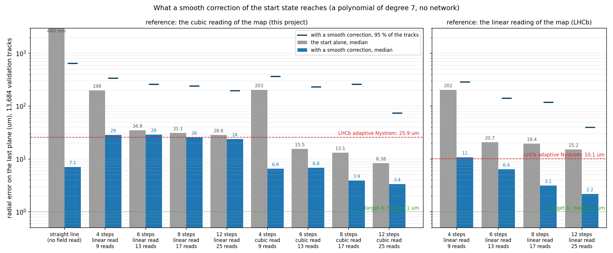

# Stage 2, preparation: what must a correction learn?

Written by `scripts/write_preparation_note.py` from the tables in `results/`. No network is trained. A method of stage 2 is `end state = start + correction(start state)`. The start is the straight line or a fixed-step integrator with a few steps. The tables give the size of the correction and what a smooth function of the start state can give of it: a polynomial, fitted with a robust loss on the 108,915 training tracks and scored on the 13,684 validation tracks. The test tracks are not used. Errors are the distance on the last plane, in um.

## Reference: the cubic reading of the map (the reference of the experiment)

| Start | Field reads | Start alone: median | 95 % | worst band | Exponent k of error ~ |q/p|^k | With a polynomial of degree 3: median / 95 % / worst band | degree 5 | degree 7 |
|---|---|---|---|---|---|---|---|---|
| the straight line | 0 | 449,000 | 1,260,000 | 1,240,000 | 1.03 | 549 / 4,400 / 1,350 | 37.1 / 1,350 / 140 | 7.09 / 645 / 46.5 |
| Nystrom, 4 equal steps, linear reading | 9 | 198 | 2,980 | 806 | 1.35 | 47.3 / 516 / 174 | 30.6 / 379 / 117 | 28.6 / 336 / 113 |
| Nystrom, 6 equal steps, linear reading | 13 | 34.9 | 299 | 134 | 1.26 | 30.2 / 256 / 109 | 28.9 / 253 / 105 | 28.8 / 259 / 111 |
| Nystrom, 8 equal steps, linear reading | 17 | 31.1 | 257 | 112 | 1.22 | 25.8 / 227 / 91.3 | 26 / 238 / 89.3 | 25.6 / 241 / 92.4 |
| Nystrom, 12 equal steps, linear reading | 25 | 28.6 | 213 | 101 | 1.17 | 24.1 / 187 / 81 | 24 / 189 / 79.4 | 23.8 / 195 / 79.9 |
| Nystrom, 4 equal steps, cubic reading | 9 | 203 | 2,900 | 774 | 1.36 | 30.9 / 496 / 120 | 7.32 / 423 / 45.4 | 6.58 / 365 / 42.8 |
| Nystrom, 6 equal steps, cubic reading | 13 | 15.5 | 318 | 61.8 | 1.41 | 12.5 / 254 / 50.1 | 6.88 / 205 / 34 | 6.83 / 231 / 35.3 |
| Nystrom, 8 equal steps, cubic reading | 17 | 13.1 | 249 | 50.8 | 1.50 | 5.36 / 253 / 25.2 | 4.97 / 252 / 27 | 3.89 / 260 / 21.8 |
| Nystrom, 12 equal steps, cubic reading | 25 | 8.38 | 79.8 | 32.3 | 1.29 | 4.33 / 70.1 / 18.8 | 3.75 / 68.9 / 17.7 | 3.36 / 73.7 / 17 |

Median error by momentum band with the polynomial of degree 7:

| Start | below 3 GeV | 3 to 8 GeV | 8 to 20 GeV | 20 to 50 GeV | above 50 GeV |
|---|---|---|---|---|---|
| the straight line | 46.5 | 13.7 | 2.99 | 0.728 | 0.242 |
| Nystrom, 4 equal steps, linear reading | 113 | 46.9 | 17.9 | 7.06 | 2.93 |
| Nystrom, 6 equal steps, linear reading | 111 | 49.5 | 19.5 | 7.78 | 2.66 |
| Nystrom, 8 equal steps, linear reading | 92.4 | 42 | 17.5 | 7.31 | 2.71 |
| Nystrom, 12 equal steps, linear reading | 79.9 | 39.7 | 17.2 | 7.51 | 2.69 |
| Nystrom, 4 equal steps, cubic reading | 42.8 | 13.4 | 2.71 | 0.944 | 0.506 |
| Nystrom, 6 equal steps, cubic reading | 35.3 | 13 | 3.26 | 1.11 | 0.468 |
| Nystrom, 8 equal steps, cubic reading | 21.8 | 7.45 | 1.44 | 0.52 | 0.241 |
| Nystrom, 12 equal steps, cubic reading | 17 | 6.3 | 1.61 | 0.473 | 0.126 |

## Reference: the linear reading of the map (the field of LHCb)

| Start | Field reads | Start alone: median | 95 % | worst band | Exponent k of error ~ |q/p|^k | With a polynomial of degree 3: median / 95 % / worst band | degree 5 | degree 7 |
|---|---|---|---|---|---|---|---|---|
| Nystrom, 4 equal steps, linear reading | 9 | 202 | 3,060 | 783 | 1.36 | 37.6 / 457 / 155 | 10.6 / 321 / 69.6 | 10.7 / 288 / 64.3 |
| Nystrom, 6 equal steps, linear reading | 13 | 20.7 | 223 | 78.8 | 1.22 | 9.49 / 148 / 43.9 | 6.35 / 136 / 34.3 | 6.4 / 140 / 38.5 |
| Nystrom, 8 equal steps, linear reading | 17 | 19.4 | 152 | 63.6 | 1.29 | 4.7 / 119 / 24.3 | 4.75 / 123 / 25.2 | 3.14 / 118 / 19.7 |
| Nystrom, 12 equal steps, linear reading | 25 | 15.2 | 98.2 | 55.2 | 1.26 | 2.61 / 38.5 / 13.1 | 2.48 / 35.1 / 12.2 | 2.18 / 39.9 / 12.1 |

Median error by momentum band with the polynomial of degree 7:

| Start | below 3 GeV | 3 to 8 GeV | 8 to 20 GeV | 20 to 50 GeV | above 50 GeV |
|---|---|---|---|---|---|
| Nystrom, 4 equal steps, linear reading | 64.3 | 21.7 | 4.1 | 1.1 | 0.438 |
| Nystrom, 6 equal steps, linear reading | 38.5 | 12.5 | 2.77 | 0.821 | 0.322 |
| Nystrom, 8 equal steps, linear reading | 19.7 | 6.25 | 1.15 | 0.371 | 0.184 |
| Nystrom, 12 equal steps, linear reading | 12.1 | 4.24 | 0.974 | 0.307 | 0.0904 |

## The start with no field read at higher degrees (cubic reference)

| Degree | Monomials | Median | 95 % | below 3 GeV | 3 to 8 GeV | 8 to 20 GeV | 20 to 50 GeV | above 50 GeV |
|---|---|---|---|---|---|---|---|---|
| 5 | 126 | 37.1 | 1,350 | 140 | 61.2 | 24.1 | 14.7 | 7.54 |
| 7 | 462 | 7.09 | 645 | 46.5 | 13.7 | 2.99 | 0.728 | 0.242 |
| 9 | 1287 | 4.51 | 442 | 34.8 | 8.99 | 2.18 | 0.895 | 0.357 |
| 11 | 3003 | 4.41 | 524 | 39.5 | 8.58 | 1.74 | 0.546 | 0.176 |

## The polynomial as a method: the baseline for the networks

The corrections of degree 7 (and degree 9 with no field read) are written for the compiled program and scored and timed there like every method of stages 0 and 1: the 13,447 test tracks, single precision, one track a call, one pinned core of stbc-i3.nikhef.nl (`scripts/polynomial_baseline.py`, `results/polynomial_baseline.csv`). The compiled correction gives the numbers of the numpy version for 9 of 9 corrections (largest difference 5.0e-12 mm in double precision).

**Reference: the linear reading (the field of LHCb)**

| Method | Field reads | Time a track (ns) | Median error (um) | 95 % (um) | Worst band (um) |
|---|---|---|---|---|---|
| HLT1 parametrised step | 0 | 384 | 55.6 | 2,330 | 1,170 |
| Straight line + polynomial of degree 7 | 0 | 432 | 27.5 | 512 | 115 |
| Nystrom, 6 steps, alone | 13 | 482 | 20.6 | 216 | 79.2 |
| Nystrom, 8 steps, alone | 17 | 652 | 19.4 | 141 | 63.7 |
| Nystrom, 6 steps + polynomial of degree 7 | 13 | 915 | 6.17 | 132 | 38.6 |
| Nystrom, 12 steps, alone | 25 | 981 | 15.2 | 94.7 | 54.9 |
| Nystrom, 8 steps + polynomial of degree 7 | 17 | 1095 | 3.09 | 103 | 19.7 |
| Nystrom, 12 steps + polynomial of degree 7 | 25 | 1433 | 2.15 | 36.8 | 12.3 |
| HLT2 adaptive Cash-Karp | 42.6 | 1809 | 22.2 | 112 | 47.3 |
| HLT2 adaptive Nystrom (LHCb reference) | 55.7 | 3592 | 10.1 | 38.8 | 16.2 |

**Reference: the cubic reading (the reference of the experiment)**

| Method | Field reads | Time a track (ns) | Median error (um) | 95 % (um) | Worst band (um) |
|---|---|---|---|---|---|
| Straight line + polynomial of degree 7 | 0 | 410 | 6.69 | 622 | 49.8 |
| Straight line + polynomial of degree 9 | 0 | 770 | 4.35 | 386 | 32.7 |
| Nystrom, 4 steps, alone | 9 | 869 | 200 | 2,840 | 760 |
| Nystrom, 4 steps + polynomial of degree 7 | 9 | 1327 | 6.49 | 310 | 41.6 |
| Nystrom, 8 steps, alone | 17 | 1657 | 13 | 211 | 50.7 |
| Nystrom, 8 steps + polynomial of degree 7 | 17 | 2112 | 3.68 | 226 | 21.9 |
| Nystrom, 12 steps, alone | 25 | 2386 | 8.51 | 72.5 | 33.3 |
| Nystrom, 12 steps + polynomial of degree 7 | 25 | 2824 | 3.33 | 57.3 | 17.6 |
| HLT2 adaptive Nystrom, as LHCb runs it, against the cubic reference | 55.7 | 3568 | 25.9 | 169 | 83.7 |

The code of the polynomial is a first version: a correction of degree 7 takes about 0.4 us, which is more than its arithmetic needs (462 terms a component).

## What the tables say

1. With no field read, a smooth function of the start state comes to a few um in the median against the cubic reference. Against the linear reference it stops near 28 um (degree 7): the linear reading has kinks at the planes of its grid, and the end state is not a smooth function of the start state at that scale.
2. A smooth correction of a fixed-step integrator lowers its median error by a factor of 2 to 7 when the integrator reads the same map as the reference. When it reads the map linearly and the reference is cubic, the correction gains almost nothing: the difference of the two readings is not smooth.
3. The correction grows faster than |q/p| (exponent 1.1 to 1.5) and its 95 % level is 10 to 100 times its median. A plain least-squares fit is ruled by about 1 % of the tracks (low momentum, large |y| on the last plane) and makes the typical track worse; the robust fit does not. The loss of a network must be robust in the same way.
4. The gain stops between degree 5 and degree 7 for the integrator starts: what is left is not smooth at this resolution.
5. On the test tracks and in the compiled program, the integrator with 12 steps and a polynomial correction is better than the adaptive Nystrom integrator of LHCb in the median, at 95 % and in the worst band, in less than half of its time. The straight line with a polynomial correction (no field read) is better than the HLT1 parametrised step in the same three numbers, in about the same time. A network of stage 2 must beat these.
