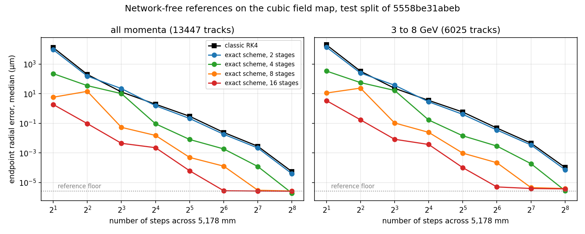

# What are the classical references on the cubic map

**Last updated:** 2026-11-22 · **State:** done (no farm; stbc-i2, 8 workers, about 40 minutes)

## What this directory is

The network-free references on the cubic field map, over the 13,447 test tracks of `5558be31abeb`: classic fourth-order Runge-Kutta, and the exact Gauss-Legendre scheme at 2, 4, 8 and 16 stages, each at 2 to 256 steps. The cubic map is the standard for every metric from 2026-11-22. Every network trained on the cubic set is compared with these numbers.

## Contents

| Name | What it does | State |
|---|---|---|
| `analysis/classical_references.py` | `rk4`: RK4 at 2 to 256 steps; `exact W`: the exact scheme at every steps and stages, on W workers. Statistics per momentum band | done |
| `analysis/draw_figure.py` | draws the figure from the tables | done |
| `analysis/results/rk4.csv`, `analysis/results/exact_scheme.csv` | the 16th, 50th and 84th percentiles of the endpoint radial error, all momenta and the five bands | done |
| `analysis/figures/references_against_steps.png` | the median against the number of steps, all momenta and 3 to 8 GeV | done |

The per-track errors and the end states are in `/data/bfys/gscriven/rkpinn_analysis_cache/what_are_the_classical_references_on_the_cubic_map`.

## Method

The error is the radial distance at the last plane (7826.0 mm) from the sixth-order reference at 0.1 mm stored with the tracks, in micrometres.

The exact scheme is reached by Newton sweeps of the whole track (`evaluation/newton_sweep.py`), from the forward-Euler path, until the largest residual of the stage equations is below 1e-10. Every cell converged in 3 to 5 sweeps. This costs seconds to minutes a cell, where the root finder of `track_data/exact_states.py` costs 1.6 s a track at 64 steps and 2 stages. The two agree: at 2, 4 and 8 steps with 2 stages the largest end-state difference over all 13,447 tracks is 2.3e-5, 1.0e-4 and 6.1e-5 µm (column `largest_difference_to_the_root_finder_micrometres`).

## Results

Endpoint radial median, µm, all 13,447 test tracks:

| Steps | RK4 | Exact, 2 stages | Exact, 4 stages | Exact, 8 stages | Exact, 16 stages |
|---|---|---|---|---|---|
| 2 | 13,109 | 9,431 | 228 | 5.83 | 1.88 |
| 4 | 201 | 155 | 35.2 | 14.5 | 0.0959 |
| 8 | 13.2 | 22.2 | 10.2 | 0.0538 | 0.00449 |
| 16 | 1.96 | 1.56 | 0.0933 | 0.0153 | 0.00227 |
| 32 | 0.301 | 0.214 | 0.00815 | 0.000501 | 0.0000625 |
| 64 | 0.0244 | 0.0183 | 0.00187 | 0.000128 | 0.0000028 |
| 128 | 0.00283 | 0.00216 | 0.000122 | 0.0000030 | 0.0000027 |
| 256 | 0.0000549 | 0.0000398 | 0.0000019 | 0.0000027 | 0.0000026 |

3 to 8 GeV (6,025 tracks):

| Steps | RK4 | Exact, 2 stages | Exact, 4 stages | Exact, 8 stages | Exact, 16 stages |
|---|---|---|---|---|---|
| 16 | 3.56 | 2.86 | 0.169 | 0.0247 | 0.00375 |
| 32 | 0.580 | 0.407 | 0.0144 | 0.000972 | 0.000102 |
| 64 | 0.0482 | 0.0357 | 0.00293 | 0.000219 | 0.0000051 |
| 128 | 0.00457 | 0.00348 | 0.000189 | 0.0000046 | 0.0000040 |

## Findings

- RK4 at 64 steps gives 0.0244 µm and the exact two-stage scheme 0.0183 µm. Both agree with the earlier measurements (0.02435 µm on these tracks; 0.01763 µm on a random 1,452 of them).
- Below about 3e-6 µm no scheme falls further. That is the error of the reference itself (sixth-order at 0.1 mm), not of the schemes.
- At few steps the curves are irregular: 8 stages rise from 5.83 µm at 2 steps to 14.5 µm at 4 steps, and 2 stages at 8 steps (22.2 µm) are above RK4 (13.2 µm). A step of 650 to 2,600 mm spans much of the magnet, so the error there depends on where the stage points fall.
- The 3 to 8 GeV median is 1.5 to 2x the all-momenta median in every cell above the floor.

## Not done here

The root finder also wrote the exact states of the test split at 2 stages into the store (`track_data/exact_states.py`, started 2026-11-22), so the standard report of each cubic run can read them.
